<a href="https://www.cristianlopez.site">
  <picture>
    <source media="(prefers-color-scheme: dark)" srcset="assets/banner-dark.svg">
    
  </picture>
</a>

 

  Soy <b>Cristian López</b>, ingeniero de software en Colombia. 
  Construyo <a href="https://lumia-ai.co">Lumia AI</a> y <a href="https://scope-ai.co">Scope</a> con un equipo de 7 agentes de IA que hace sus videos todos los días. 
  En mis redes te muestro cómo lo armé, paso a paso.

  <a href="https://www.youtube.com/@milodev10"><picture><source media="(prefers-color-scheme: dark)" srcset="assets/social-youtube-dark.svg"></picture></a>
  <a href="https://www.tiktok.com/@milodev10"><picture><source media="(prefers-color-scheme: dark)" srcset="assets/social-tiktok-dark.svg"></picture></a>
  <a href="https://www.instagram.com/milodev1031"><picture><source media="(prefers-color-scheme: dark)" srcset="assets/social-instagram-dark.svg"></picture></a>
  <a href="https://www.linkedin.com/in/cristian-lopez-dev/"><picture><source media="(prefers-color-scheme: dark)" srcset="assets/social-linkedin-dark.svg"></picture></a>
  <a href="https://www.cristianlopez.site"><picture><source media="(prefers-color-scheme: dark)" srcset="assets/social-web-dark.svg"></picture></a>

 

<picture><source media="(prefers-color-scheme: dark)" srcset="assets/title-episode-dark.svg"></picture>

<!-- latest-episode -->
<a href="https://youtu.be/TqvCwIajeyY">
  <picture>
    <source media="(prefers-color-scheme: dark)" srcset="assets/episode-dark.svg">
    
  </picture>
</a>
<!-- /latest-episode -->

<picture><source media="(prefers-color-scheme: dark)" srcset="assets/title-projects-dark.svg"></picture>

  <a href="https://lumia-ai.co"><picture><source media="(prefers-color-scheme: dark)" srcset="assets/project-lumia-dark.svg"></picture></a>
  <a href="https://scope-ai.co"><picture><source media="(prefers-color-scheme: dark)" srcset="assets/project-scope-dark.svg"></picture></a>
  <a href="https://github.com/CamiloLopezN/CamiloLopezN/blob/main/resources/team-map.pdf"><picture><source media="(prefers-color-scheme: dark)" srcset="assets/project-studio-dark.svg"></picture></a>

<a href="https://github.com/CamiloLopezN/CamiloLopezN/blob/main/resources/team-map.pdf">
  <picture>
    <source media="(prefers-color-scheme: dark)" srcset="assets/team-map-dark.svg">
    
  </picture>
</a>

<picture><source media="(prefers-color-scheme: dark)" srcset="assets/title-career-dark.svg"></picture>

<picture>
  <source media="(prefers-color-scheme: dark)" srcset="assets/career-dark.svg">
  
</picture>

 

  ¿Hablamos? Escríbeme por <a href="https://www.linkedin.com/in/cristian-lopez-dev/">LinkedIn</a> o déjame un comentario en cualquier video.

